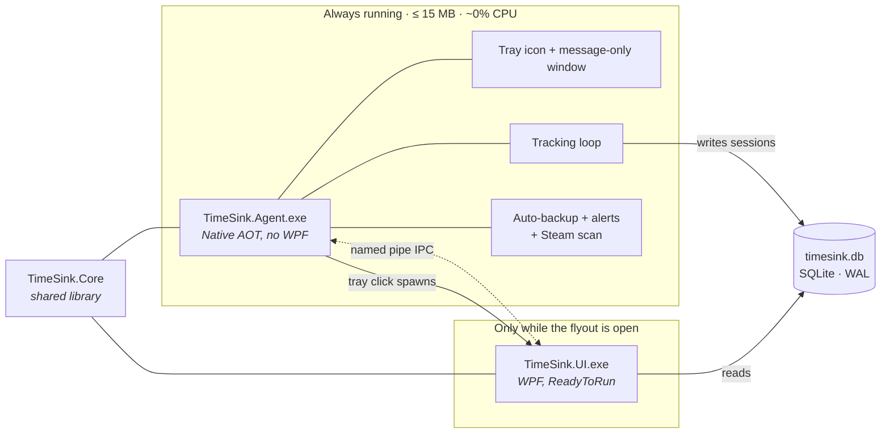
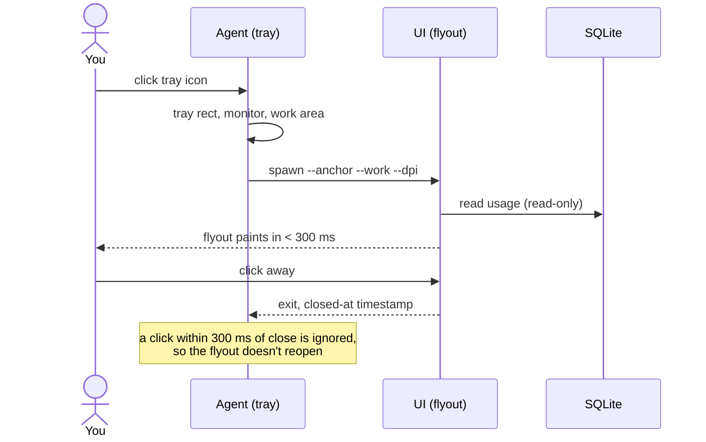

<div align="center">

# ⏱️ TimeSink

### See how long your apps have *really* been open.

A featherweight Windows tray app that records, Steam-style, how long the apps **you choose** are running,
then turns it into Today, Week, Month, Year and All-time views in a flyout above your taskbar.


[**Features**](#-core-features) · [**Architecture**](#-architecture) · [**Install**](#-install) · [**Build**](#-build-from-source) · [**Privacy**](#-privacy)

</div>

---

## 🖼️ At a glance

```text
 ┌─────────────────────────────────────────┐
 │ ● TimeSink                          ⚙   │
 │  Today │ Week │ Month │ Year │ All      │
 ├─────────────────────────────────────────┤
 │  PC uptime today                        │
 │  6h 42m 18s            ● 3 running      │
 │                                         │
 │  ▁▂▂▃▅▆▆▇█▇▆▅▃▂ ·  ·  ·  ·              │  hourly chart + "typical day"
 │  6  9  12  15  18  21                   │
 │                                         │
 │  ┌─First app─┐┌─Longest───┐┌─vs yest.─┐ │
 │  │ 8:04 am   ││ 4h 09m    ││ +12 min  │ │
 │  └───────────┘└───────────┘└──────────┘ │
 │                                         │
 │  🟢 Code        Running · 1h 02m   4h 51m│
 │  🔵 Firefox     Closed 11:12 am    2h 10m│
 │  🟣 Spotify     Running            1h 33m│
 ├─────────────────────────────────────────┤
 │  + Add app              Updated just now│
 └─────────────────────────────────────────┘
```

> The flyout is a fixed **420 × 620** panel that sits flush against the taskbar on any edge and any monitor.
> It opens in well under 300 ms and closes itself when you click away.

---

## ✨ Core features

### 📊 Five views, one tray click

| View | What you get |
|:--|:--|
| **📅 Today** | PC uptime with ticking seconds, an hourly chart with a dotted *typical day* marker, three stat tiles (first app, longest session, vs yesterday), and per-app rows with a 24-hour session strip. Tap a row for its sessions and a 7-day comparison. |
| **📈 Week** | Seven columns for the week, a 20-week heat grid with your current streak, and a sparkline per app. Browse earlier and later weeks, and click a day for its detail. |
| **🗓️ Month** | A calendar heatmap with a weekly total column, the delta against last month over the same number of days, daily average, best day, and the top apps. Exports to CSV. |
| **🏆 Year** | **Pace** (monthly bars with a projected finish), **Wrapped** (total hours, top-3 podium, habits) and an **App × month matrix**. Save Wrapped as an image. |
| **📋 All** | A dense, sortable table: hours, days used, average per day and share. Retired apps are listed below, dimmed. Exports to CSV. |

### 🎯 You decide what is tracked

- **Opt-in only.** Nothing is recorded until you add the app, and time counts from the moment you add it.
- **Three ways to add.** Pick from **Running** apps, search the **Installed** list (Start Menu and packaged apps), or **Browse** and drop in an `.exe` or `.lnk`.
- **Suggestions.** Running apps you haven't tracked appear in a card with a one-click **Track** button, or **Not this one** to dismiss.
- **Steam auto-tracking.** Steam games can be found and tracked automatically.
- **Merge and group.** Fold several executables into one *Main app* (launcher plus game, or old and new installs) and the history adds up.
- **Retire, don't delete.** Stop tracking an app and its history stays. You can restore it later.
- **Background apps.** Always-on apps (Steam, Wallpaper Engine) still count toward totals but are listed last.
- **Your own icons.** Use the extracted icon, or choose one from the built-in icon packs.

### 🧠 Honest, simple tracking

| Rule | Meaning |
|:--|:--|
| **Open time, not focus time** | An app counts while any of its processes is alive. No idle detection and no foreground hooks. |
| **Sleep-aware** | Optionally pause while the PC sleeps and keep counting when locked. |
| **Short-session filter** | Ignore runs shorter than 5, 15 or 30 seconds. |
| **Crash-safe** | Sleep, shutdown, crashes and restores never corrupt the database or double count time. |
| **Daylight saving safe** | Days are real local days, 23 or 25 hours long when the clocks change. |

### 🔔 Gentle nudges

- Goal and limit alerts.
- A weekly summary notification.
- Nothing ever blocks or closes an app.

### 🎨 Themes and personalisation

- **Dark**, **Light** or **System** (follows Windows), built on theme tokens and a string table. Nothing visual is hard-coded.
- Accent colours: **Lime**, **Blue**, **Pink**.
- **Compact lists** and a configurable **week start** (Mon, Sun or Sat).
- Windows 12/24-hour clock respected.

### 💾 Your data stays yours

| | |
|:--|:--|
| **Backup** | One-click `.timesink` backup, or automatic daily or weekly with retention (last 7 plus one per month). |
| **Restore** | **Replace** your database (a safety backup is made first) or **Merge**, which is idempotent, so importing the same file twice changes nothing. |
| **Export** | CSV or JSON of everything. Month and All have their own CSV export. |
| **Delete** | Wipe all history from Settings after typing `DELETE`. |
| **Autostart** | Start with Windows is **on by default** and can be turned off in Settings. |

---

## 🏗️ Architecture

TimeSink is two small processes that share a SQLite file. The **Agent** is always running and must stay tiny.
The **UI** exists only while the flyout is open.



### 🔁 From tray click to flyout



### 🧱 Solution layout

```text
timesink/
├── src/
│   ├── TimeSink.Core/      domain + logic: tracking engine, usage queries, backup, IPC, theming
│   ├── TimeSink.Agent/     tray, Win32 process detection, DB writer, schedulers  (Native AOT)
│   └── TimeSink.UI/        flyout, views, hand-drawn charts, settings               (WPF)
├── tests/TimeSink.Tests/   xUnit tests against Core with fakes
├── themes/                 pulse-dark · pulse-light  (theme.json)
├── design/                 approved visual boards (HTML)
├── installer/              Inno Setup script + packaging and test scripts
├── tools/icons/            icon-pack sources
└── docs/                   decisions log, manual test checklist
```

| Project | Role | Notes |
|:--|:--|:--|
| 🧩 **Core** | All the rules | UI-free and testable. Tracking, usage windows and queries, backup and restore, IPC, themes, settings. |
| 🛰️ **Agent** | Always-on watcher | Native AOT, no WPF/WinForms, AOT-safe code only. Re-adds its tray icon after an Explorer restart. |
| 🪟 **UI** | The flyout | Plain WPF with custom flat templates. Charts are drawn with primitives, with no chart library. |

### 🧭 Design principles

1. **Lightweight first**: the Agent stays small and idle-quiet.
2. **Opt-in tracking**: only apps you add are recorded, and never titles, keystrokes, URLs or screenshots.
3. **Local only**: no network, no telemetry, no accounts.
4. **Open time, not focus time.**
5. **The database is the source of truth.**
6. **Per-user install**: no admin rights anywhere.
7. **No hard-coded colours, fonts or text**: they all come from theme tokens and the string table.

---

## 📦 Install

> **Requires** Windows 11 (Windows 10 22H2 works with flat fallbacks). **No admin rights needed.**

### Option A · Installer *(recommended)*

1. Download and run **`TimeSink-Setup-<version>.exe`**.
2. It installs per user to `%LocalAppData%\Programs\TimeSink`.
3. Tick **Start TimeSink now** on the last page. TimeSink appears in the tray, and Start with Windows is on by default.
4. Click the tray icon, then **+ Add app** to pick what to track.

### Option B · Portable

1. Unzip **`TimeSink-portable-win-x64.zip`** anywhere you can write to.
2. Run **`TimeSink.Agent.exe`**. This is the tray app, and it starts the UI on demand.
3. Keep the `ui` folder next to `TimeSink.Agent.exe`.

The portable copy still keeps its data in `%LocalAppData%\TimeSink`.

### 🗂️ Where your data lives

`%LocalAppData%\TimeSink\`

| Item | Path |
|:--|:--|
| 🗄️ Database | `timesink.db` (plus `-wal` and `-shm` while running) |
| 💾 Backups | `backups\` (`.timesink` files, automatic daily by default) |
| 📝 Log | `logs\agent.log` (1 MB × 3, no window titles or content) |

### 🚚 Moving to another PC

**Settings → Backup now**, copy the `.timesink` file across, then **Settings → Restore** on the new machine.

### 🧹 Uninstall

- **Installer:** Settings → Apps → Installed apps → TimeSink → Uninstall. It stops the Agent and UI, removes the
  Start with Windows entry, and asks whether to delete `%LocalAppData%\TimeSink`. Answer **No** to keep your history.
- **Portable:** turn off *Start with Windows* in Settings, quit from the tray menu, then delete the folder.
  Delete `%LocalAppData%\TimeSink` too if you want your data gone.

---

## 🛠️ Build from source

**Needs:** the .NET 10 SDK and the Visual Studio C++ Build Tools (for Native AOT). Inno Setup 6 is optional and only needed for the installer.

```powershell
dotnet test                                  # run the test suite
pwsh installer\Build-Package.ps1             # publish Agent (AOT) + UI (ReadyToRun, self-contained)
pwsh installer\Build-Package.ps1 -Test       # ...and verify the zip against scratch databases
```

Output goes to `artifacts\` (gitignored): `TimeSink-portable-win-x64.zip` and, if `iscc.exe` is found,
`TimeSink-Setup-<version>.exe`. `installer\Test-Package.ps1 -Smoke` checks any zip without touching your real data.

---

## 🔒 Privacy

| ✅ TimeSink does | ❌ TimeSink never |
|:--|:--|
| Store the exe path and start/stop times of apps **you** chose | Read window titles, documents, focus or idle time |
| Keep everything in one local SQLite file | Use the network, accounts, cloud sync or update checks |
| Let you export, back up, restore and wipe everything | Send telemetry |
| | Block or close any app |

---

## 📚 Project docs

| Doc | Purpose |
|:--|:--|
| [`implementation.md`](implementation.md) | The full spec |
| [`docs/decisions.md`](docs/decisions.md) | Decisions that override the spec |
| [`GLOSSARY.md`](GLOSSARY.md) | Domain language (Tracked app, Session, Local day…) |
| [`design/`](design) | Approved visual boards |
| [`docs/manual-tests.md`](docs/manual-tests.md) | Manual test checklist |

## 📄 Licence

No licence file has been added yet.
